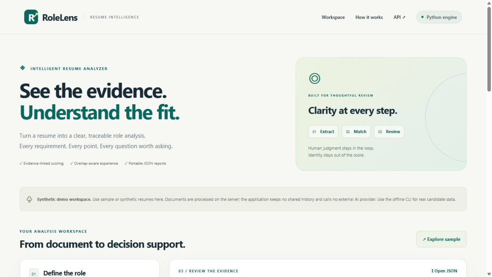
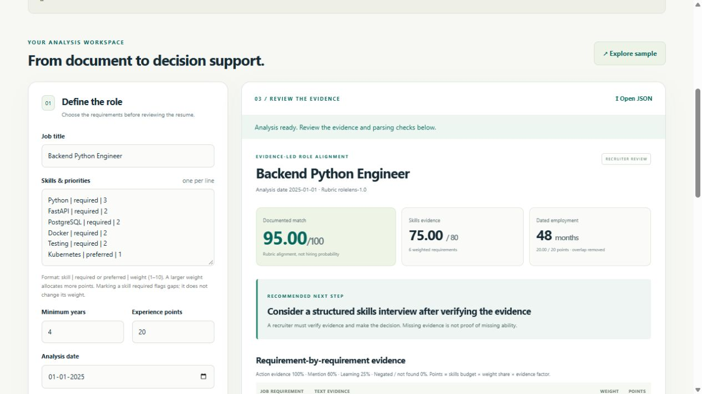
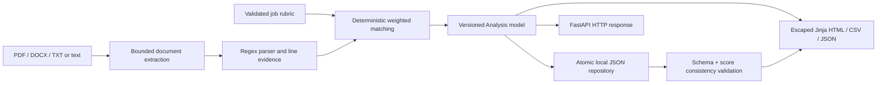

<div align="center">

# 🔎 RoleLens

### Evidence before decisions.

## Intelligent Resume Analyzer

**Python + Regular Expressions**

[](pyproject.toml)
[](app/main.py)
[](https://github.com/Janicebenita/Intelligent_Resume_Analyzer_hidevs/actions/workflows/quality.yml)
[](LICENSE)

**📄 Parse → 🧩 Match → 🔍 Inspect → 📦 Export**

[🚀 Open the live Python app](https://rolelens-resume-mu.vercel.app) · [🧪 Inspect the CI results](https://github.com/Janicebenita/Intelligent_Resume_Analyzer_hidevs/actions)

</div>



RoleLens turns a resume and a recruiter-defined job rubric into a transparent 0–100 alignment report. Every skill point links to source text. Dated employment is calculated without double-counting concurrent roles. Missing evidence and extraction uncertainties are visible alongside practical follow-up questions.

**This is a Python application, including the deployed scoring engine.** The small browser script coordinates forms and displays server-rendered results. There is no external LLM, API key, vector database or hidden AI score.

> 🛡️ **Recruiter decision support, not autonomous hiring.** Resume claims are unverified. Scores measure the configured rubric, not ability or job-success probability. Use synthetic resumes on the public demo; process real candidate data with the offline CLI in an appropriately secured environment.

### ✨ What you can do

| Capability | Implementation |
|---|---|
| 📄 Extract resume information | PDF text, DOCX paragraphs/tables/headers, UTF-8/UTF-16 TXT; names, email, skills and employment |
| 🔗 Inspect the evidence | 1-based line references, section context, evidence strength, source hash and analysis date |
| ⚖️ Configure the rubric | Required/preferred skills, alias-aware duplicate checks, per-skill weights, experience target and budget |
| 🧮 Understand each point | Full action evidence, partial mentions/learning, zero for absent or negated skills |
| 🗓️ Audit employment | Month/year/numeric/ISO date ranges, current roles, date clipping and overlap removal |
| 📦 Save and reopen | Versioned JSON, schema validation and recalculated score consistency on import; atomic local saves |
| 📝 Share a professional report | Escaped standalone HTML for Print/Save as PDF, JSON, spreadsheet-safe CSV |
| 🧯 Recover from bad input | Typed errors for damaged, encrypted, empty, scanned, oversized or unsupported files |



*The sample's 95/100 is a resume-to-role rubric score, not a project evaluation score. All displayed candidate information is synthetic.*

### 🚀 Run locally

Python 3.12+ is required. The lockfile pins direct and transitive dependencies.

```bash
python -m venv .venv
# Windows: .venv\Scripts\activate
# macOS/Linux: source .venv/bin/activate
python -m pip install -r requirements.txt
python -m uvicorn app.main:app --host 127.0.0.1 --port 7860 --no-access-log
```

Open **http://127.0.0.1:7860**. Choose **Explore sample**, inspect/edit the role, then **Analyze role alignment**. The sample intentionally contains overlapping jobs, self-reported years and a skill still being learned.

Requirements use one line each:

```text
Python | required | 3
FastAPI | required | 2
Docker | preferred | 1
```

The importance label flags gaps; the numeric weight controls points. A role without a minimum experience target automatically allocates all points to skills.

### 💻 Offline CLI and real JSON file operations

```bash
python -m app.cli --resume docs/examples/synthetic-resume.txt --job docs/examples/job.json --as-of 2025-01-01 --store data --html report.html
python -m app.cli --load REPORT_ID_FROM_JSON --store data
```

The first command writes `data/<report-id>.json` using a same-directory temporary file, flush/fsync and atomic replacement. The second opens and validates that JSON file. File IDs cannot traverse directories. Corrupted files and permission errors produce actionable messages and nonzero exit codes. The CLI operates offline and does not require the web server.

The public web application deliberately keeps no shared server-side report library. **Export JSON** and **Open JSON** provide portable saving/loading without exposing one visitor's report to another. The original rubric/date remain with an imported report. Serverless filesystems are ephemeral; this app does not claim durable cloud storage.

### 🧮 Scoring specification

Let `E` be the experience budget (0–50), `wᵢ` each skill weight (1–10), and `fᵢ` the evidence factor:

| Text evidence | Factor | Meaning |
|---|---:|---|
| Evidenced | 1.00 | Skill occurs after a recognized action verb in an Experience/Projects clause |
| Mentioned | 0.60 | Skill appears, without action evidence |
| Learning | 0.25 | Skill follows a learning/familiarity marker |
| Negated or not found | 0.00 | Explicit lack or no matching skill evidence |

```text
skill pointsᵢ = (100 − E) × wᵢ / sum(weights) × fᵢ
experience points = E × min(1, unique employment months / (12 × target years))
match score = skill points + experience points, rounded to 2 decimals and capped at 100
```

Each row is stored to four decimals. Tiny rounding differences may occur when manually summing displayed two-decimal rows. The thresholds (80/55) and factors are explicit **design choices, not empirically calibrated hiring thresholds**. A required skill that is absent, negated or still being learned overrides the optimistic recommendation with a request to clarify gaps.

Example independent arithmetic: 80 skill points, Python weight 3 with action evidence, Docker weight 1 with only a mention, and 24 months against a 48-month target yields `60 + 12 + 10 = 82`.

Employment dates are interpreted as half-open month intervals. Past end months are inclusive, Present counts completed months, and all intervals are unioned. Education/projects are excluded. Year-only dates use January boundaries and carry an uncertainty warning. Claimed “15 years experience” never replaces dated evidence. Total employment is **not** a verified measure of years in a particular skill.

### 🏗️ Architecture



| Module | Responsibility |
|---|---|
| `app/documents.py` | Format signatures, size/page/expansion limits, text extraction |
| `app/parser.py`, `app/skills.py` | Names, email, aliases, clause evidence, dates and interval union |
| `app/models.py` | Pydantic contracts, schema version, invariants and input validation |
| `app/matching.py` | Pure explainable rubric and follow-up recommendations |
| `app/storage.py` | JSON interchange, consistency checks and atomic local persistence |
| `app/reports.py`, `app/templates/` | Escaped UI/report rendering and safe CSV |
| `app/service.py` | Shared orchestration for web, CLI and evaluation |
| `app/main.py`, `app/cli.py` | Thin HTTP/CLI boundaries and safe error responses |

### 🧪 Verification

```bash
# Install uv from its official distribution, then:
uv sync --frozen --extra dev
uv run ruff check app tests scripts
uv run ruff format --check app tests scripts
uv run mypy app
uv run pytest --cov=app --cov-report=term-missing
uv run python -m scripts.evaluate
npm ci --ignore-scripts
npm run lint
npm run format:check
npm test
```

The suite checks actual multipart uploads, independently calculated scores, overlapping dates, name/email extraction, aliases and substring collisions, JSON round trips, malformed imports, path traversal, permission errors, HTML escaping, CSV formula handling, HTTP privacy headers and the offline CLI. DOM tests cover browser-form orchestration and recovery. The Python coverage gate is **95% across the application**, not just the scoring function. Coverage is a regression signal, not a correctness guarantee.

The published benchmark contains **12 authored synthetic English resumes**, labeled for name, email, complete detected skill set and employment months at a fixed analysis date. It is small, authored by the project and not independently labeled. It cannot establish production parsing accuracy or hiring validity. CI publishes the actual evaluation and test artifacts; see [evaluation method](docs/EVALUATION.md).

### ☁️ Deployment

The same FastAPI entrypoint runs locally, in Docker and on Vercel's Python runtime. Vercel deployment configuration is in `vercel.json`; Python dependencies are locked in `uv.lock` and hash-pinned `requirements.txt`.

```bash
docker build -t rolelens .
docker run --rm -p 7860:7860 rolelens
python scripts/smoke.py --url http://127.0.0.1:7860
```

The GitHub workflow runs lint/types/tests/evaluation/UI checks, then builds the non-root container and exercises its HTTP flow. **Deployment wiring and live verification status are recorded in [release readiness](docs/RELEASE_READINESS.md); workflow configuration alone is not evidence of a successful deployment.** No paid hosting upgrades or add-ons are part of this project.

### ⚠️ Boundaries and responsible use

- English-centric heuristics can miss unusual names, unsectioned resumes, complex layouts, mixed-language text and unconventional date formats. Review extraction warnings and source evidence.
- Scanned PDFs need external OCR. There is no OCR engine in this release.
- Recognized text is a claim, not verified proficiency. Keyword stuffing, sophisticated negation and long ambiguous clauses can mislead a rule-based parser.
- Names, email, personal characteristics, photographs and school prestige are excluded from the score. This does not establish fairness or legal compliance. Recruiters must assess job relevance and use consistent assessments.
- JSON import checks schema and internal score consistency; it does **not** authenticate the author or prove the source is genuine. Reports are not cryptographically signed.
- The hosted demo is public and unauthenticated, for synthetic data. The app retains no report history, but hosting infrastructure may process operational metadata. Do not upload real candidate data there.
- Production hiring use would need authentication, authorization, secure retention, monitored availability, abuse controls, consent workflows, broader independent evaluation and expert review. These are not claimed as completed.

### 🎯 HiDevs criterion mapping

| Criterion | Reviewable evidence |
|---|---|
| Code quality | Modular typed Python; strict mypy; Ruff; locked dependencies; CI |
| Parsing accuracy | Format tests, 12-case labeled synthetic corpus, exact source references and warnings |
| Matching algorithm | Published formula, independent arithmetic tests, alias boundaries and evidence factors |
| File operations | JSON schema, web import/export, atomic repository saves and reopen tests |
| Report generation | Shared professional HTML template, JSON/CSV export and follow-up recommendations |
| Error handling | Typed input/storage errors; safe HTTP/CLI failures; malformed/oversized/encrypted fixtures |

Built by **Janice Benita F**, with AI-assisted implementation and verification. The design and limitations are documented so the approach can be inspected and explained. A higher evaluation score is an aspiration, not a guarantee.
